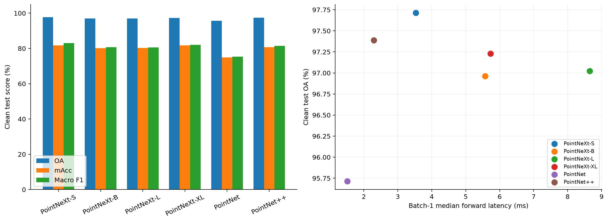
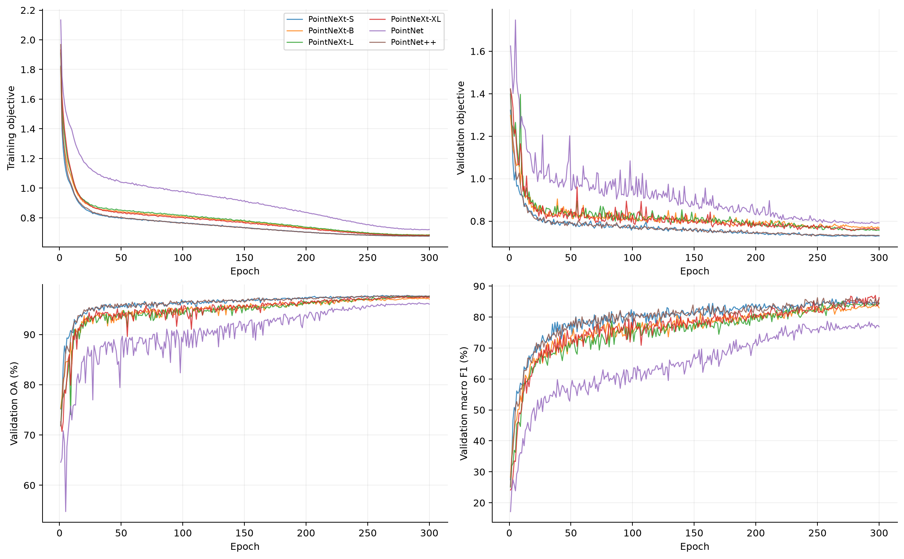
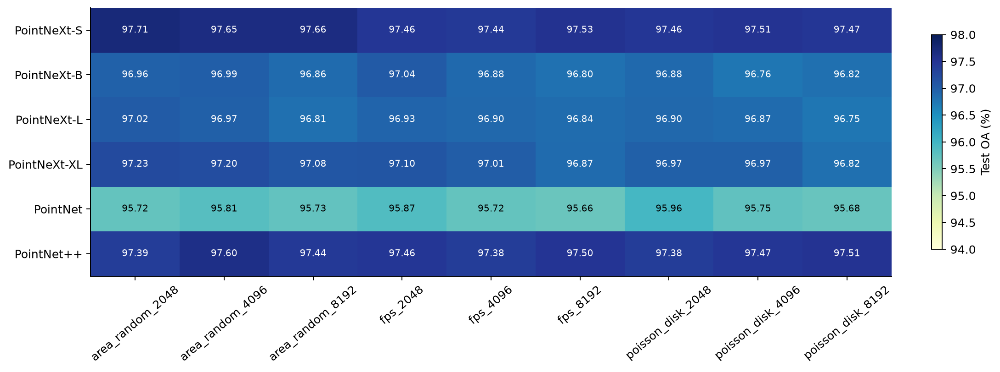
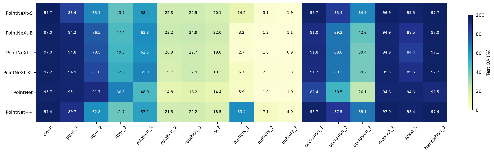
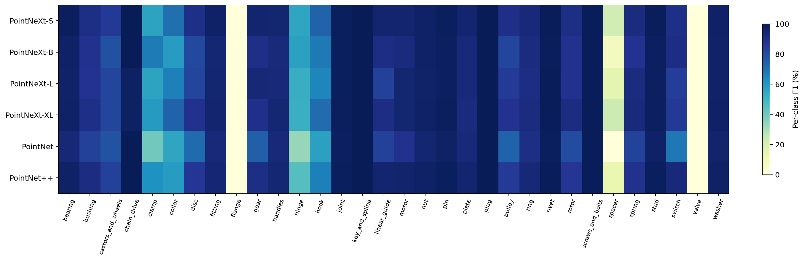
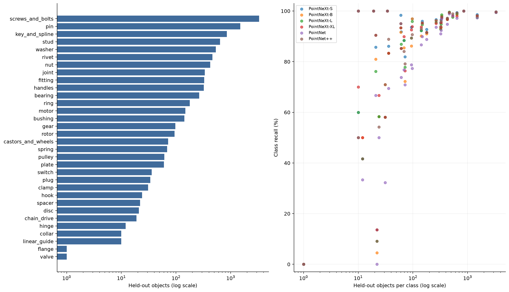

# MCB-32 工业点云分类：受控实验与结果分析

[English](KEY6.md) | [简体中文](KEY6.zh-CN.md) · [项目主页](../../README.zh-CN.md) · [指标归档](../../reports/key6/)

分析日期：2026-10-16（北京时间）。本报告为已完成 key6 实验的公开分析，原始备份保持不变。

## 结论

在本次固定配置、单个随机种子下，**PointNeXt-S 的干净测试 OA（97.71%）、Macro F1（83.03%）最高**。PointNet++ 的 OA 为 97.39%，Macro F1 为 81.39%，单模型前向延迟更低，而且 1% 离群点和遮挡条件下优于 S。PointNeXt-XL 的 OA 为 97.23%、Macro F1 为 82.03%，耗时明显更高，没有在本组配置中超过 S。XL 的 mAcc 为 81.72%，略高于 S 的 81.70%，因此不能说 S 在所有指标上都最好。

这些结果支持把 S 作为当前干净 CAD 分类的优先候选，把 PointNet++ 作为重要的效率和鲁棒性对照。所有模型对任意姿态和离群点都较脆弱，暂不能据此认定已经适合真实扫描点云。

## 1. 完成范围、数据和公平性

六个模型均成功完成 300 轮，总计 **1,800 轮、192 项测试**，没有失败实验。最后完成时间为北京时间 **2026-10-16 08:06:31**。每个模型使用同一套面积随机采样 2,048 点、float32 XYZ 的数据训练，32 个类别；训练/验证/测试数量为 **36,380 / 4,044 / 10,107**。验证集从原始训练集按类别划分，原始测试集保持独立。九种点云表示复用相同模型 ID 和划分；同一 ID 的九种表示不会跨训练、验证、测试集合。

配置为 seed=42、AdamW、学习率 0.001、权重衰减 0.05、300 轮、10 轮 warmup、cosine 调度、标签平滑 0.1、dropout 0.5、有效及实际 batch 均为 32。标准增强包括打乱点顺序、逐轴缩放及平移，**没有训练旋转、噪声或离群点增强**。均在同一 RTX 4070 12 GB 上使用 BF16 混合精度，输入文件仍是 float32。最佳检查点按验证集 Macro F1、OA、loss 顺序选择，没有用测试集挑选轮次。

S 使用官方 ModelNet 分类编码器配置；B/L/XL 使用官方 S3DIS 编码器并接分类头，保留各自层数、宽度和下采样结构。因此这是一组明确配置下的工业分类适配实验，**不是所有版本已充分调参的比较，也不是官方分割任务的复现**。S 与 B/L/XL 的下采样结构不同，参数量与训练时间不必单调对应。

每个模型 32 项测试：1 项干净测试、8 项其他采样/点数表示、7 种扰动各 3 个强度、1 项点顺序置换、1 项均匀 SO(3) 旋转。各项测试均使用全部 10,107 个留出模型。

**当前只在一种点云上训练。其余八套用于同一模型 ID 的跨表示测试，不能得出“九种训练数据谁最好”或“最佳超参数”的结论。** 跨表示稳定性也不等于跨数据源、跨设备或真实扫描泛化。


同一个留出 gear 模型在固定视角下的九种表示。示例按文件名确定，不根据识别正确与否挑选；仅说明数据对应关系，不是分类结果图。

## 2. 干净测试集分类效果

| 模型 | OA % | mAcc % | Macro F1 % | Loss | NLL | 最佳轮次 |
| --- | --- | --- | --- | --- | --- | --- |
| PointNeXt-S | 97.71 | 81.70 | 83.03 | 0.7334 | 0.1853 | 282 |
| PointNeXt-B | 96.96 | 80.09 | 80.75 | 0.7756 | 0.2317 | 262 |
| PointNeXt-L | 97.02 | 80.25 | 80.65 | 0.7779 | 0.2295 | 270 |
| PointNeXt-XL | 97.23 | 81.72 | 82.03 | 0.7731 | 0.2280 | 297 |
| PointNet | 95.72 | 74.98 | 75.40 | 0.7972 | 0.2534 | 258 |
| PointNet++ | 97.39 | 80.77 | 81.39 | 0.7395 | 0.1959 | 250 |

OA 是按样本统计的总体准确率；mAcc 是 32 类召回率的平均；Macro F1 是 32 类 F1 的平均。类别较不均衡，应结合三者判断。S 比 PointNet++ 高 **0.326 个 OA 百分点**和 **1.646 个 Macro F1 百分点**，比 PointNet 高约 **2.00 个 OA 百分点**。B/L/XL 在本组配置下未显示比 S 更好的干净测试 OA 或 Macro F1。

测试 Loss 使用相同的标签平滑交叉熵，不包含 PointNet 的特征变换正则项；PointNet 优化训练目标时另加入该正则项。比较预测概率质量时可以同时查看未平滑 **NLL**。S 的 NLL 最低（约 0.1853），PointNet++ 次之（约 0.1959）。表内 loss 不是普通未平滑交叉熵。



## 3. 训练与推理效率

| 模型 | 参数量 M | 训练+验证 小时 | 单模型中位延迟 ms | batch=8 吞吐 模型/秒 |
| --- | --- | --- | --- | --- |
| PointNeXt-S | 1.371 | 6.39 | 3.531 | 1088.5 |
| PointNeXt-B | 3.879 | 3.64 | 5.572 | 1432.8 |
| PointNeXt-L | 7.176 | 5.91 | 8.653 | 932.5 |
| PointNeXt-XL | 40.840 | 17.58 | 5.727 | 523.3 |
| PointNet | 3.477 | 2.57 | 1.515 | 3206.1 |
| PointNet++ | 1.470 | 6.37 | 2.293 | 1101.0 |

训练+验证时间是逐轮 `train.elapsed_s + val.elapsed_s` 的总和，不包含测试、保存检查点、启动、编译、数据核验及中断等待；纯训练时间另见 `model_comparison.csv`。S 曾从第 118 轮恢复，这里累计所有 300 轮记录；不能把套件中 S 的约 370 秒状态时长当成完整训练时间。六个模型上述训练+验证累计约 **42.46 小时**。

推理时间是在 GPU 已驻留输入上测量前向传播，10 次预热、30 次重复，含同步；不包含 OBJ 转点云、磁盘读取、数据传输和服务开销。batch=8 吞吐不等于单模型实时延迟，也不是对完整测试集的端到端测速。该短基准使用同一个样本扩展 batch，后续部署应再测实际请求。

PointNet 最快但准确率和小类表现较低；PointNet++ 的单模型延迟约 2.293 ms，优于 S 的 3.531 ms。B 的训练快于 S 与其更激进的下采样结构有关，不能只按参数量解释速度。这些是本次运行的观测耗时，不是严格排除 I/O 和系统负载的稳态吞吐基准；S 早期与数据上传重叠，且经历中断恢复，解释耗时差异时应保留这一限制。XL 的训练+验证时间约是 S 的 **2.75 倍**，当前没有获得对应的干净分类收益。

## 4. 学习曲线和检查点



各模型均完成预定轮次。最佳验证检查点大多出现在后期，PointNet++ 为第 250 轮，XL 为第 297 轮。S 最终训练 OA 约为 99.77%，而测试 OA 为 97.71%，存在泛化差距。小类验证样本极少，Macro F1 会因少量预测变化而跳动，不能把单轮波动直接当成训练异常。完整逐轮数值保存在公开归档各运行的 `history.csv` 中。训练每轮丢弃不足 batch 的最后 28 个对象，打乱顺序后每轮被丢弃的对象会变化。PointNet 的训练 loss 含变换正则项，与测试 loss 的定义不同。

## 5. 九种点云表示的跨表示测试

| 模型 | 其余 8 套平均 OA % | 其余 8 套 OA 范围 % |
| --- | --- | --- |
| PointNeXt-S | 97.52 | 97.44–97.66 |
| PointNeXt-B | 96.88 | 96.76–97.04 |
| PointNeXt-L | 96.87 | 96.75–96.97 |
| PointNeXt-XL | 97.00 | 96.82–97.20 |
| PointNet | 95.77 | 95.66–95.96 |
| PointNet++ | 97.46 | 97.38–97.60 |

S 在其他八种表示上的 OA 为 97.44%–97.66%，相对其原始表示下降很小；PointNet++ 在这些表示上为 97.38%–97.60%。说明这两者对本数据集的采样方式和输入点数变化较稳定。增加测试点数没有带来一致收益。

S 在泊松盘 4,096 点输入上 Macro F1 为 83.87%，高于其原始表示的 83.03%，但 OA 略低。这是**同一个 2,048 点训练模型**的测试结果，不能据此声称“泊松盘 4,096 点训练最优”。完整 6×9 的干净表示结果见 [cross_representation_54.csv](../../reports/key6/tables/cross_representation_54.csv)。



图中每一行始终使用面积随机 2,048 点训练的同一检查点。色标范围较窄，应结合数值判断差异；九列共享模型 ID，不能当作九次独立重复。

## 6. 鲁棒性：分类准确并不代表抗扰动

下表均为 OA（%）。噪声单位是归一化坐标；SO(3) 为均匀任意姿态。

| 扰动 | 强度 1 | 强度 2 | 强度 3 | 实现 |
| --- | --- | --- | --- | --- |
| jitter | σ=0.005 | σ=0.01 | σ=0.02 | 独立高斯坐标噪声，截断至 ±3σ |
| rotation | 15° | 45° | 90° | 随机轴、固定角度 |
| scale | 1.15 | 1.30 | 1.50 | 各对象等概率乘该值或其倒数 |
| translation | 0.05 | 0.10 | 0.20 | 随机方向平移、所列为向量长度 |
| dropout | 10% | 30% | 50% | 随机移除后重复剩余点补齐 |
| outliers | 1% | 5% | 10% | 替换为 [-1,1] 立方体均匀点 |
| occlusion | 10% | 30% | 50% | 沿随机方向投影截断后重复补齐 |

`permutation` 只打乱点顺序，`so3` 使用均匀随机单位四元数旋转。各扰动是在归一化点云上直接施加，测试时不额外重新居中或缩放。

| 模型 | 噪声 σ=.005 | 旋转 15° | 任意旋转 | 1% 离群点 | 50% 遮挡 | 50% 随机丢点 |
| --- | --- | --- | --- | --- | --- | --- |
| PointNeXt-S | 83.45 | 58.37 | 20.11 | 14.22 | 64.93 | 96.86 |
| PointNeXt-B | 94.20 | 63.31 | 21.98 | 3.20 | 42.62 | 94.87 |
| PointNeXt-L | 94.78 | 62.45 | 19.78 | 2.68 | 39.37 | 94.89 |
| PointNeXt-XL | 94.89 | 65.86 | 19.32 | 6.67 | 39.21 | 95.55 |
| PointNet | 95.06 | 47.99 | 14.43 | 5.90 | 26.06 | 94.56 |
| PointNet++ | 89.67 | 57.16 | 18.54 | 63.35 | 69.14 | 96.97 |



主要发现：

- **姿态敏感。** 15° 绕随机轴旋转后 OA 大幅下降，任意 SO(3) 旋转后所有模型只有约 14%–22%。训练增强没有包含旋转，因此结果与训练、测试姿态分布不一致相符；这不是旋转不变性模型。
- **离群点敏感。** 1% 点替换为 [-1,1] 立方体均匀离群点时，S 只有 14.22%，PointNet++ 为 63.35%；5% 离群点下 PointNet++ 也只有约 7.10%。PointNet++ 在轻度离群点下相对更好，但仍不足以支持不经处理的扫描输入。扰动是人为构造的压力测试，不能等同于任意传感器噪声。
- **局部遮挡比随机丢点更困难。** 保留 50% 点后重复补齐输入点数时，随机丢点下 S 仍有 96.86%，平面裁剪遮挡下只有 64.93%；PointNet++ 对应为 96.97% 和 69.14%。遮挡测试只是按投影截断的近似，没有模拟深度相机可见性。
- **微小位置噪声存在模型差异。** σ=0.005 时 S 为 83.45%，B/L/XL 约 94%–95%，PointNet 为 95.06%，说明 S 并非所有扰动下最好。更强噪声仍显著降低准确率。
- **对平移和随机丢点相对稳定。** 这与训练时的平移增强及点云冗余相符。点顺序置换后的指标有轻微变化，分层采样和邻域选择可能受顺序影响，不能宣称严格置换不变。

## 7. 少数类别与错误分布

测试集中最大类为 `screws_and_bolts`，占 **32.71%**。高 OA 受大类影响；S 的 Macro F1 比 OA 低约 14.68 个百分点。以下为 S 的 F1 最低八类：

| 类别 | 测试样本 | S Precision % | S Recall % | S F1 % |
| --- | --- | --- | --- | --- |
| flange | 1 | 0.00 | 0.00 | 0.00 |
| valve | 1 | 0.00 | 0.00 | 0.00 |
| spacer | 22 | 50.00 | 13.64 | 21.43 |
| hinge | 12 | 83.33 | 41.67 | 55.56 |
| clamp | 31 | 54.55 | 58.06 | 56.25 |
| collar | 10 | 85.71 | 60.00 | 70.59 |
| hook | 24 | 100.00 | 58.33 | 73.68 |
| castors_and_wheels | 72 | 90.77 | 81.94 | 86.13 |

`flange`、`valve` 各只有 **1 个测试样本**，本次各模型均未识别正确，无法可靠评估这两个类别；单个样本变化就会改变一个类别的得分。`spacer` 有 22 个测试样本，S 的召回率只有 13.64%，是比总体 OA 更值得优先解决的问题。完整 32 类 ×6 模型的 precision、recall、F1 和支持数见 `per_class_clean.csv`；原始混淆矩阵保留在各模型 `tests/clean.json` 中。



S 将 22 个 spacer 中的 **17 个预测为 washer**，实际正确识别 3 个。这提示需要检查间隔件与垫圈的几何相似性、类别边界和小类训练数据；仅凭混淆矩阵尚不能断言错误原因。其他高频混淆包括 pin→screws_and_bolts（9 个）和 pin→stud（6 个）。详细记录见 [s_confusions.csv](../../reports/key6/tables/s_confusions.csv)。



左图使用对数轴显示各类测试对象数量，右图比较支持数和召回率。它描述类别不平衡，不能将类别难度与样本量的相关关系当作因果证明。

## 8. 对比较差异的统计边界

以下将 S 与五个模型在同一批测试模型上的“预测是否正确”配对，使用双侧精确 McNemar 检验，并对所列五次比较做 Holm 校正。这是观察结果后的补充分析，参照模型 S 为当前干净测试最优者，并非预注册的确证性检验；这些校正值不能保证所有数据驱动模型比较的总体错误率：

| S 对比模型 | 仅 S 正确 | 仅对方正确 | OA 差值 百分点 | 配对精确 p | Holm 校正 p |
| --- | --- | --- | --- | --- | --- |
| PointNeXt-B | 120 | 44 | 0.752 | 2.461e-09 | 9.845e-09 |
| PointNeXt-L | 119 | 49 | 0.693 | 6.646e-08 | 1.994e-07 |
| PointNeXt-XL | 96 | 47 | 0.485 | 5.104e-05 | 0.0001021 |
| PointNet | 247 | 45 | 1.999 | 6.275e-35 | 3.137e-34 |
| PointNet++ | 73 | 40 | 0.327 | 0.002456 | 0.002456 |

这只检验当前这六个已训练检查点在当前留出对象上的配对 OA 差异，**没有衡量不同训练种子的波动**，也没有检验 Macro F1 的显著性。对象之间潜在的系列/近似几何相关性仍可能影响独立样本假设。仅一个 seed，不能把当前排名推广为算法普遍优劣。不要根据本次测试结果持续调参后仍把同一测试集作为无偏最终评估。

## 9. 后续实验优先级

1. 首先补足少数类数据并核对相近类别边界，按类检查错误对象；保留独立测试集。可在训练集/验证集内比较类别加权或均衡采样，以 Macro F1 为主要选择指标。
2. 在预算有限时优先用 S 比较九套训练数据，固定划分和其他条件；这一步才能回答训练采样方式和点数的影响。对选定候选至少补做三个训练种子后报告均值、标准差。
3. 如果目标是任意姿态或扫描输入，单独增加旋转/噪声/离群点增强对照，保持当前结果作为基线；结合清理离群点或姿态对齐，再用独立真实扫描数据验证。不要直接覆盖当前六项实验。
4. 在实际推理硬件测包含加载、预处理、传输的端到端延迟。继续保留 PointNet++，它在这组数据中是很有竞争力的对照。

这些是基于本次结果的后续方案，**本次没有额外启动训练或更改已完成的配置**。

## 10. 公开材料、备份和复现

完整本地备份为 2,283 个文件、1,413,216,937 字节，包括最佳/最终权重、原始预测和逐轮指标，逐文件 SHA-256 与服务器一致。全部 192 份预测 NPZ、共 1,940,544 条预测已核对对象 ID/标签、概率有限及归一化，并从预测重新计算混淆矩阵、OA、mAcc、Macro F1，均与原始记录一致。这项核验没有从原 logits 独立重算 loss，loss 仍为训练程序的原始评估输出。

GitHub 的 [reports/key6/](../../reports/key6/) 发布配置、完整指标 JSON、训练历史、重复测速数据和核验证据；`metrics-and-protocol.zip` 内含全部 192 个指标 JSON 和各模型完整 history.csv。**权重与逐对象概率 NPZ 保留在本地备份，不在此 Git 仓库中提供下载。** 数据集单独位于 [GeorgeWJJ/PointNext](https://huggingface.co/datasets/GeorgeWJJ/PointNext)，按原 NPY 字节分片，并提供准确的实验划分。

无需 GPU 即可检查公开归档、核对混淆矩阵指标并重建六组 PNG/SVG 图表：

```bash
python -m pip install -r scripts/requirements-release.txt
python scripts/build_publication.py
```

重建六组指标图表不需要本地完整备份；点云数据对照图另需下载的数据及 `scripts/plot_sampling_preview.py`。预测级核验需要原 NPZ。CSV 指标采用 0–1 比例，报告显示为百分数；分析轮次按 1 开始，原始 epoch 按 0 开始。准确的数据、划分指纹及环境信息在 `reports/key6/protocol/`。独立 GPU 重复运行可能因 CUDA 原子操作无法逐位相同。

云端复制未携带 Git 目录，因此原环境中记录提交号的探测失败。另行按套件算法核对固定提交工作区的 **148 个源文件**，内容指纹与云端实验记录完全一致，证明见 [source_verification.json](../../reports/key6/protocol/source_verification.json)；保留原环境记录，不改写历史证据。

本次六项结果来自单个训练种子，不能将九种相关表示或连续训练轮次伪装成多次独立训练来报告均值±标准差。ID 分离不能排除同系列近似 CAD 的相关性；跨表示测试也不是跨数据源泛化。S/B/L/XL 结构不仅参数量不同，因此不能将本比较解释为严格的单因素模型规模实验。

参考来源：[MCB / ECCV 2020](https://github.com/stnoah1/mcb)、[PointNeXt / NeurIPS 2022](https://arxiv.org/abs/2206.04670)、[PointNet](https://arxiv.org/abs/1612.00593)、[PointNet++](https://arxiv.org/abs/1706.02413)。完整文献见 [references.bib](../references.bib)。数据权利与代码许可范围见[第三方声明](../../THIRD_PARTY_NOTICES.md)。
