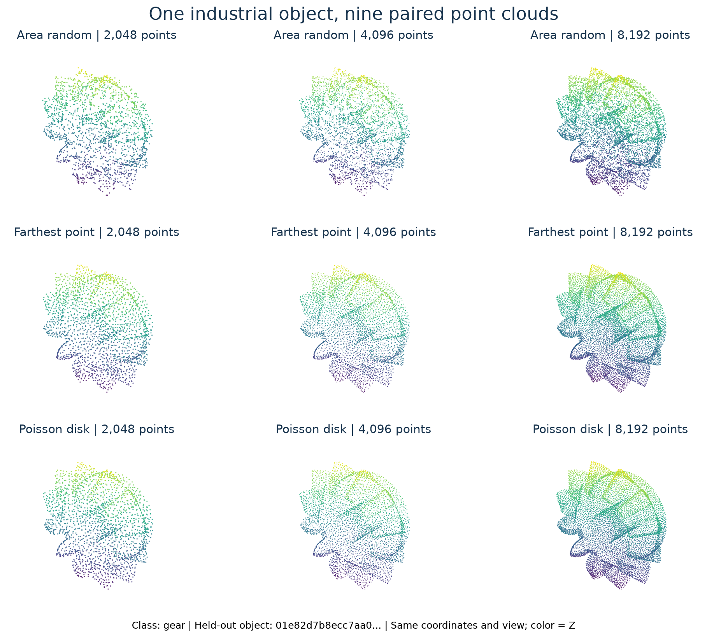

# MCB-32 工业零部件配对点云

[English](README.md) | [简体中文](README.zh-CN.md) · [代码与报告](https://github.com/13536309143/pointnext)

## 概况

本数据集是 Mechanical Components Benchmark（MCB）的研究整理版，包含 **50,531 个独立模型、32 个零部件粗类别、九种配对点云表示**，用于整件工业零部件分类。九个版本来自同一批模型，454,779 个 NPY 不代表同等数量的独立对象。本整理版不是官方 MCB 发布。

三种方法为按面积随机采样、贪心最远点采样（FPS）、泊松盘式样本消除，点数分别为 **2,048、4,096、8,192**。所有文件均为连续存储的 NumPy `float32`，形状 `(N,3)`，只含 XYZ，不含法线、颜色、物理尺寸、传感器测量或逐点标签。类别表达机械零部件类型，同时涉及形状和用途，不是材质或缺陷标签。

本次分发九套点云；原始合并 OBJ 留在本地用于重新转换，不包含在点云归档中。



同一个留出 gear，使用固定视角与坐标系，仅展示数据，不是识别成功案例。本发布为原始 NPY 的 TAR 分片，已关闭不适用的表格预览；请按下面的方法下载与校验。

## 数量与文件

每套原始 train/test 为 **40,424 / 10,107**；对应已完成实验的 train/val/test 为 **36,380 / 4,044 / 10,107**。共 454,779 个 NPY，逻辑字节数 **26,137,058,688（24.34 GiB）**。

为了避免数十万个仓库条目，使用约 512 MiB 的无压缩 TAR 分片，保留原始 NPY 的字节和相对路径；TAR 头与补齐会增加一定体积。`release_manifest.json` 记录每片路径、大小、SHA-256、版本、原始划分及文件数，`SHA256SUMS` 另覆盖元数据与说明文档。本数据是 NumPy 文件集合，不是已经配置好的 `load_dataset()` 表格。

```text
archives/<variant>/train-00000.tar
archives/<variant>/test-00000.tar
metadata/class_to_idx.json
metadata/class_counts.json
metadata/experiment_splits.csv.gz
metadata/file_manifest.csv.gz
release_manifest.json
SHA256SUMS
```

归档内部保留：

```text
MCB_pointcloud/<variant>/train/<class>/<model_id>.npy
MCB_pointcloud/<variant>/test/<class>/<model_id>.npy
```

九个 variant 分别为 `area_random_2048/4096/8192`、`fps_2048/4096/8192`、`poisson_disk_2048/4096/8192`（每个点数独立目录）。类别映射按英文目录名字典序，从 0 到 31。

## 配对关系与划分

九套版本的模型 ID、类别和原始划分一致。64 位十六进制 `model_id` 是网格整理阶段留下的稳定编号，不是当前 NPY 的内容哈希；内容校验请使用文件清单。

实验验证集仅从原 train 中按类别划出，split seed 为 `20261013`，原 test 保持不变。`experiment_splits.csv.gz` 同时保留实验 `split` 和原始文件 `relative` 路径；验证对象在磁盘上仍位于 `train/` 目录。

同一对象的不同表示必须留在相同集合，不能把九套数据独立随机划分，或合并为九倍独立样本。按 ID 分离仍不能排除同系列、近似几何零件之间的相关性。

## 下载和读取

递归克隆实验仓库后执行：

```bash
python -m pip install huggingface_hub numpy
python scripts/download_dataset.py --repo-id GeorgeWJJ/PointNext --output data
```

默认 Hugging Face 缓存会在解压后保留 TAR。完整下载与解压建议预留约 55 GiB 空闲磁盘，训练输出另计。

只下载一个版本可增加 `--variant area_random_2048`；完整实验需要九套。为复现准确版本可添加 `--revision <数据集提交号>`。程序核对分片 SHA-256、拒绝越界或链接类归档路径，恢复原始 NPY 目录；不下载原始网格。

```python
from pathlib import Path
import numpy as np
p = next(Path("data/MCB_pointcloud/area_random_2048/train").glob("*/*.npy"))
xyz = np.load(p, allow_pickle=False)
assert xyz.dtype == np.float32 and xyz.shape == (2048, 3)
label = p.parent.name
```

## 几何与采样

源 OBJ 以包围盒中心为原点、最大顶点半径为 1，保留源模型方向。点云直接继承此坐标系，不依据有限采样点再次居中或缩放；因此采样点自身包围盒中心不一定恰好是零，最大半径也不一定恰好是 1。

每个模型先按三角面面积加权生成 **40,960 个候选点**，三角面内部用平方根重心坐标采样。中间计算使用 float64，候选点去重及保存坐标采用 float32。

- **面积随机**：取候选池前 8,192 点，较小档位使用嵌套子集。分布与表面积对应，允许局部聚集。
- **FPS**：候选池第 0 点为起点，按欧氏距离贪心选至 8,192 点，较小档位为选择序列前缀。KD 树与索引最大堆加速最近距离更新，保持贪心规则。
- **泊松盘式消除**：采用 Yuksel 风格加权样本消除，按 40,960→8,192→4,096→2,048 逐级删除拥挤点，各阶段更新半径。参数 alpha=8、beta=0.65、gamma=1.5。结果近似均匀/蓝噪声，不保证严格统一最小间距。

同一方法下三档点集满足 `2048 ⊂ 4096 ⊂ 8192`，保存前独立打乱行顺序，不能按行号对应。基础种子 42 与源相对路径、随机流名称通过 SHA-256 派生独立种子；原始生成使用 NumPy 2.5.4。具体公式、程序和 Windows 一键转换工具在代码仓库 `data/README.md` 与 `data/_pointcloud_converter/` 中；其他实现使用相同种子不一定生成相同坐标。

打包时逐个对照**已完成实验的内容哈希清单**，再次检查形状、float32 和有限数值。原始转换还检查了重复点、源包围盒和单位球边界，并对各类代表样本做点到三角面距离核验；代表性几何检查不等同于全数据逐点几何证明。

## 类别与不平衡

| ID | 类别 | 原始训练 | 测试 | 合计 |
| --- | --- | ---: | ---: | ---: |
| 0 | `bearing` | 1,064 | 266 | 1,330 |
| 1 | `bushing` | 567 | 142 | 709 |
| 2 | `castors_and_wheels` | 289 | 72 | 361 |
| 3 | `chain_drive` | 78 | 19 | 97 |
| 4 | `clamp` | 126 | 31 | 157 |
| 5 | `collar` | 38 | 10 | 48 |
| 6 | `disc` | 82 | 21 | 103 |
| 7 | `fitting` | 1,309 | 327 | 1,636 |
| 8 | `flange` | 5 | 1 | 6 |
| 9 | `gear` | 386 | 97 | 483 |
| 10 | `handles` | 1,291 | 323 | 1,614 |
| 11 | `hinge` | 49 | 12 | 61 |
| 12 | `hook` | 97 | 24 | 121 |
| 13 | `joint` | 1,342 | 336 | 1,678 |
| 14 | `key_and_spline` | 3,408 | 852 | 4,260 |
| 15 | `linear_guide` | 39 | 10 | 49 |
| 16 | `motor` | 594 | 148 | 742 |
| 17 | `nut` | 1,696 | 424 | 2,120 |
| 18 | `pin` | 5,979 | 1,495 | 7,474 |
| 19 | `plate` | 240 | 60 | 300 |
| 20 | `plug` | 135 | 34 | 169 |
| 21 | `pulley` | 245 | 61 | 306 |
| 22 | `ring` | 711 | 178 | 889 |
| 23 | `rivet` | 1,854 | 464 | 2,318 |
| 24 | `rotor` | 375 | 94 | 469 |
| 25 | `screws_and_bolts` | 13,224 | 3,306 | 16,530 |
| 26 | `spacer` | 87 | 22 | 109 |
| 27 | `spring` | 278 | 69 | 347 |
| 28 | `stud` | 2,542 | 636 | 3,178 |
| 29 | `switch` | 143 | 36 | 179 |
| 30 | `valve` | 6 | 1 | 7 |
| 31 | `washer` | 2,145 | 536 | 2,681 |

`screws_and_bolts` 共 16,530 个，占 32.71%；`flange`、`valve` 仅 6、7 个，各只有一个测试对象。应同时报告 OA、mAcc、Macro F1、各类支持数和混淆矩阵，不能将一个测试对象的类别得分视为稳定结论。部分粗类包含多个机械子类型。

## 适用范围与实验

适合完整 CAD 表面的分类、配对采样/分辨率研究和人工扰动测试；不是实际扫描数据。尚不能代表真实设备噪声、任意姿态、离群点、遮挡或新 CAD 来源的泛化。32 类和保留模型数量属于本整理版。

关联的**已完成实验只在面积随机 2,048 点上训练六个网络**，另外八套仅对相同留出对象做跨表示测试；仅一个训练种子。不能据此判断九种训练数据的最优方案。详细结果见 [中文报告](https://github.com/13536309143/pointnext/blob/main/docs/reports/KEY6.zh-CN.md)与[英文报告](https://github.com/13536309143/pointnext/blob/main/docs/reports/KEY6.md)。

## 来源、权利与引用

来源：[stnoah1/mcb](https://github.com/stnoah1/mcb)，Kim 等人的 ECCV 2020 MCB 工作。原 MCB 从在线 CAD 仓库收集模型。本项目整理标签并将网格转换为点云，不主张原始 CAD 设计的作者身份。

**本发布不另行授予统一的数据集许可。** MCB 采集程序采用 MIT 软件许可，但这不能证明每个 CAD 资产也采用 MIT。原始资产及来源条款仍适用于派生点云，实验代码的 MIT 不能当作数据集的统一商业使用或再分发授权。使用前应核对与具体用途对应的原始条款。参见 `THIRD_PARTY_NOTICES.md`。

引用原始数据论文：

```bibtex
@inproceedings{sangpil2020large,
  title={A Large-scale Annotated Mechanical Components Benchmark for Classification and Retrieval Tasks with Deep Neural Networks},
  author={Kim, Sangpil and Chi, Hyung-gun and Hu, Xiao and Huang, Qixing and Ramani, Karthik},
  booktitle={European Conference on Computer Vision},
  year={2020}
}
```

整理与实验代码：[13536309143/pointnext](https://github.com/13536309143/pointnext)。本发布不代表原 MCB 或 PointNeXt 作者背书。
